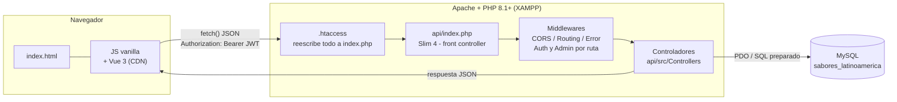
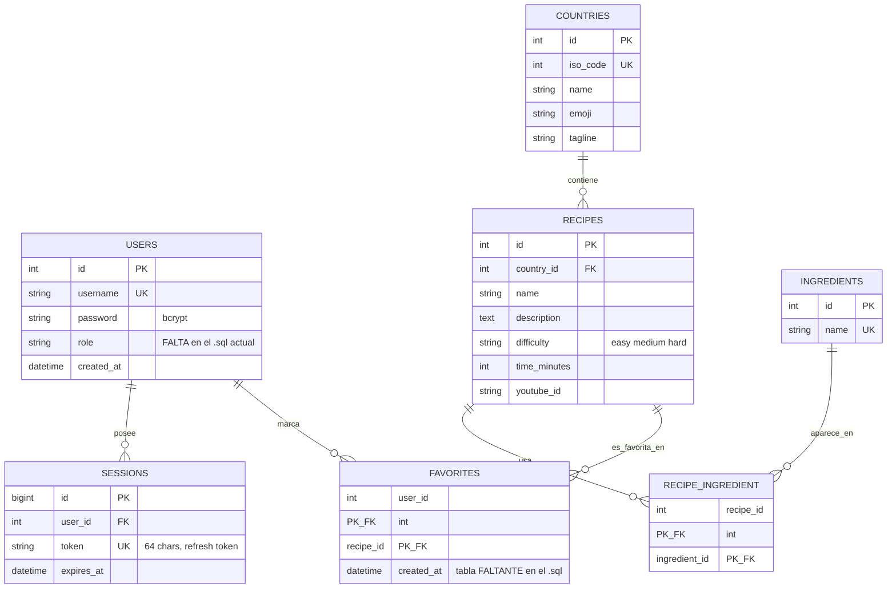
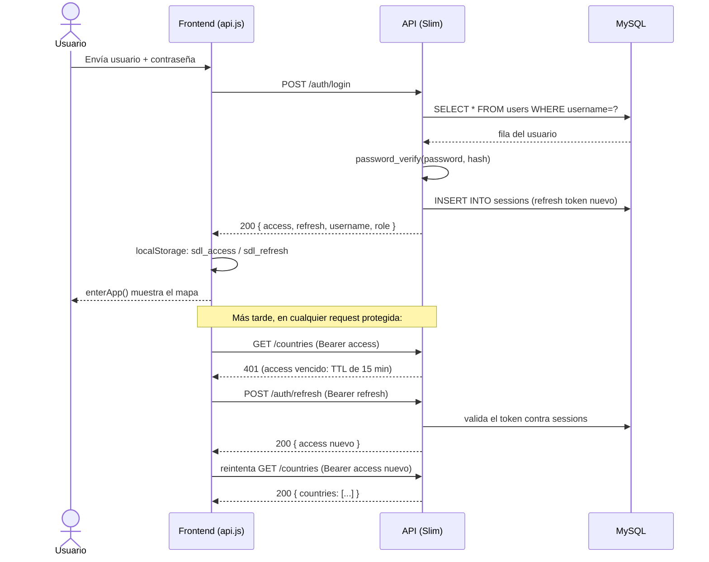

# Sabores de Latinoamérica — Documentación técnica completa

> **Propósito de este documento:** explicar el proyecto de punta a punta —arquitectura, base de datos, cada endpoint de la API, cada módulo del frontend, el flujo de autenticación y un recorrido de uso real— para que alguien (persona o IA) sin ningún contexto previo pueda entenderlo y trabajar sobre él sin tener que leer todo el código fuente primero. Todos los ejemplos (JSON, SQL, datos) están tomados del código y los datos reales del proyecto.

## Índice

1. [Qué es el proyecto](#1-qué-es-el-proyecto)
2. [Stack tecnológico](#2-stack-tecnológico)
3. [Estructura de carpetas](#3-estructura-de-carpetas)
4. [Arquitectura general](#4-arquitectura-general)
5. [Base de datos](#5-base-de-datos)
6. [Backend — API REST (PHP + Slim 4)](#6-backend--api-rest-php--slim-4)
7. [Frontend (HTML + CSS + JS vanilla + Vue 3)](#7-frontend-html--css--js-vanilla--vue-3)
8. [Autenticación y autorización: flujo completo](#8-autenticación-y-autorización-flujo-completo)
9. [Recorrido de uso de punta a punta (ejemplo real)](#9-recorrido-de-uso-de-punta-a-punta-ejemplo-real)
10. [Cómo levantar el proyecto localmente](#10-cómo-levantar-el-proyecto-localmente)
11. [Cosas importantes a tener en cuenta](#11-cosas-importantes-a-tener-en-cuenta)

---

## 1. Qué es el proyecto

**Sabores de Latinoamérica** es una aplicación web full-stack: un **atlas gastronómico interactivo** de Latinoamérica. Es una especie de single-page-app (sin router, pero con "pantallas" que se muestran/ocultan por CSS) donde el usuario:

- Ve un **mapa interactivo en SVG** de Latinoamérica, con zoom, paneo (arrastrar) y geografía real de los países.
- Hace clic en un país y se abre un **panel lateral** con sus recetas típicas: nombre, dificultad, tiempo de preparación, ingredientes y un video de YouTube.
- Puede **buscar** platos/países/ingredientes en tiempo real, marcar **recetas favoritas**, y tocar un ingrediente para ver en qué otras recetas del continente aparece.
- Si es el usuario **administrador** (automáticamente, el primero en registrarse en el sistema), tiene un botón extra que abre un **panel de administración** (alta/baja/modificación de recetas, países e ingredientes) construido como un componente de Vue 3.

Es el tipo de proyecto típico de portfolio o trabajo de curso: **backend propio en PHP** con un micro-framework (Slim 4) hablando **JSON puro** por una API REST, **base de datos MySQL propia** con datos reales de 19 países y 57 recetas, y un **frontend sin frameworks pesados ni paso de build** (JS vanilla + un único componente Vue 3 cargado por CDN). Está pensado para correr en un entorno **XAMPP** local (Apache + PHP + MySQL en `localhost`).

## 2. Stack tecnológico

| Capa | Tecnología | Detalle |
|---|---|---|
| Servidor web | Apache (vía XAMPP) | Sirve `htdocs/` como raíz del sitio |
| Backend | PHP ≥ 8.1 | `declare(strict_types=1)` en todos los archivos; autoload PSR-4 (`App\` → `api/src/`) |
| Micro-framework | [Slim 4](https://www.slimframework.com/) (`slim/slim ^4.12`, `slim/psr7 ^1.7`) | Solo enrutamiento + middlewares; **sin ORM ni motor de vistas** |
| Config | `vlucas/phpdotenv ^5.6` | Carga `api/.env` como variables de entorno |
| Base de datos | MySQL/MariaDB, charset `utf8mb4`, motor InnoDB | Acceso vía **PDO nativo** (sin ORM), 100% consultas preparadas |
| Autenticación | **JWT artesanal** (HS256, sin librerías) + refresh tokens persistidos en tabla `sessions` | Ver sección 8 |
| Frontend | HTML5 + CSS3 + JavaScript vanilla (ES6+) | Sin bundler, sin framework de routing, scripts cargados directo en `<script>` |
| Panel admin | Vue 3 (`vue.global.prod.js` vía CDN de unpkg) | Sin build step: el `template` vive como string dentro del `.js` |
| Mapa | SVG generado por JS + datos TopoJSON | Geografía real vía CDN, con **fallback** dibujado a mano si no hay conexión |
| Tipografías | Google Fonts: "Alfa Slab One" (títulos) + "Sofia Sans" (texto) | |

No hay `package.json`, ni TypeScript, ni tests automatizados, ni Docker, ni sistema de migraciones: todo el esquema de base vive en un único archivo `.sql`.

## 3. Estructura de carpetas

```
htdocs/                          ← raíz servida por Apache (carpeta típica de XAMPP)
├── index.html                   ← única página HTML de todo el frontend
├── README.md
├── css/
│   └── styles.css                ← todo el CSS del proyecto (~260 líneas, con variables :root)
├── js/
│   ├── config.js                 ← URL base de la API (1 constante)
│   ├── data.js                   ← geometría de respaldo del mapa + paleta de colores + labels de dificultad
│   ├── api.js                    ← cliente HTTP hacia la API (fetch + manejo de JWT)
│   ├── auth.js                   ← lógica de la pantalla de login/registro
│   ├── map.js                    ← mapa interactivo SVG (el módulo más complejo del proyecto)
│   ├── panel.js                  ← panel lateral de recetas + modal de ingredientes + favoritos
│   ├── admin.js                  ← panel de administración, componente Vue 3
│   └── app.js                    ← orquestador general: buscador, stats, auto-login, utilidades
├── db/
│   └── sabores_latinoamerica.sql ← script único: crea la BD, tablas, vista y datos semilla
└── api/                          ← backend completo, subcarpeta con su propio front controller
    ├── index.php                  ← front controller (arranca Slim)
    ├── routes.php                 ← definición de todas las rutas
    ├── composer.json / .lock      ← dependencias PHP
    ├── .env.example                ← plantilla de variables de entorno (copiar a .env)
    ├── .htaccess                   ← reescribe toda request hacia index.php
    ├── .gitignore                  ← ignora /vendor y .env
    ├── vendor/                     ← dependencias instaladas por Composer (Slim, PSR-7, phpdotenv)
    └── src/
        ├── Controllers/            ← 8 controladores, uno por recurso
        │   ├── AuthController.php
        │   ├── CountryController.php
        │   ├── RecipeController.php
        │   ├── IngredientController.php
        │   ├── SearchController.php
        │   ├── StatsController.php
        │   ├── FavoriteController.php
        │   └── AdminController.php
        ├── Middleware/
        │   ├── AuthMiddleware.php
        │   ├── AdminMiddleware.php
        │   └── CorsMiddleware.php
        └── Support/                 ← helpers/servicios compartidos
            ├── Env.php
            ├── Database.php
            ├── Jwt.php
            ├── Auth.php
            └── JsonResponder.php
```

Hay **dos capas independientes conviviendo en la misma carpeta servida por Apache**: el frontend estático vive en la raíz de `htdocs/`, y el backend vive en `htdocs/api/`, con su propio front controller y su propio `.htaccess`. Front y back se comunican **solo por HTTP/JSON** (`fetch`), como si fueran dos aplicaciones separadas, aunque convivan en el mismo host y XAMPP los sirva juntos.

## 4. Arquitectura general



Puntos clave:

- El **frontend no tiene paso de build**: los `<script>` se cargan uno por uno en `index.html`, en un orden que **importa**, porque cada archivo depende de variables/funciones globales que define el anterior (detalle exacto en la sección 7).
- El **backend sigue el patrón "front controller"**: toda request a `api/*` que no sea un archivo físico pasa por `api/index.php` (gracias al `.htaccess`), que arma la app de Slim, registra middlewares y rutas, y despacha al controlador correspondiente.
- **No hay vistas del lado del servidor.** El backend es una API REST pura que solo devuelve JSON. Todo el HTML lo genera el JS del cliente manipulando el DOM directamente (salvo el panel de admin, que usa Vue 3).
- La sesión **no usa cookies de PHP**: se maneja 100% con JWT en el header `Authorization: Bearer <token>`, guardado en `localStorage` del navegador.

## 5. Base de datos

### 5.1 Diagrama entidad-relación



### 5.2 Las tablas, tal como están en `db/sabores_latinoamerica.sql`

**`users`** — cuentas de usuario. La contraseña nunca se guarda en texto plano: se hashea con `password_hash()` (bcrypt) al registrarse.
```sql
CREATE TABLE `users` (
  `id`         INT NOT NULL AUTO_INCREMENT,
  `username`   VARCHAR(30)  NOT NULL,
  `password`   VARCHAR(255) NOT NULL,           -- bcrypt (password_hash)
  `created_at` DATETIME NOT NULL DEFAULT CURRENT_TIMESTAMP,
  PRIMARY KEY (`id`),
  UNIQUE KEY `uq_username` (`username`)
);
```

**`sessions`** — refresh tokens activos (uno o varios por usuario; permite tener sesión abierta en varios dispositivos y revocarlos individualmente borrando la fila).
```sql
CREATE TABLE `sessions` (
  `id`         BIGINT NOT NULL AUTO_INCREMENT,
  `user_id`    INT NOT NULL,
  `token`      CHAR(64) NOT NULL,
  `created_at` DATETIME NOT NULL DEFAULT CURRENT_TIMESTAMP,
  `expires_at` DATETIME NOT NULL,
  PRIMARY KEY (`id`),
  UNIQUE KEY `uq_token` (`token`),
  KEY `idx_sessions_user` (`user_id`),
  CONSTRAINT `fk_sessions_user` FOREIGN KEY (`user_id`) REFERENCES `users` (`id`) ON DELETE CASCADE
);
```

**`countries`** — catálogo de países. `iso_code` es el código numérico ISO 3166-1 (ej. 32 = Argentina, 484 = México); el frontend lo usa como clave para unir con la geometría del mapa.
```sql
CREATE TABLE `countries` (
  `id`       INT NOT NULL,
  `iso_code` INT NOT NULL,
  `name`     VARCHAR(100) NOT NULL,
  `emoji`    VARCHAR(10)  DEFAULT NULL,
  `tagline`  VARCHAR(150) DEFAULT NULL,
  PRIMARY KEY (`id`),
  UNIQUE KEY `uq_iso_code` (`iso_code`)
);
```

**`recipes`** — recetas, cada una ligada a un país.
```sql
CREATE TABLE `recipes` (
  `id`           INT NOT NULL AUTO_INCREMENT,
  `country_id`   INT NOT NULL,
  `name`         VARCHAR(200) NOT NULL,
  `description`  TEXT DEFAULT NULL,
  `difficulty`   ENUM('easy','medium','hard') DEFAULT NULL,
  `time_minutes` INT DEFAULT NULL,
  `youtube_id`   VARCHAR(30) DEFAULT NULL,
  PRIMARY KEY (`id`),
  CONSTRAINT `fk_recipe_country` FOREIGN KEY (`country_id`) REFERENCES `countries` (`id`)
);
```

**`ingredients`** — catálogo **único** y normalizado de ingredientes (no se repiten por receta; "Cebolla" es una sola fila aunque la usen 15 recetas).
```sql
CREATE TABLE `ingredients` (
  `id`   INT NOT NULL AUTO_INCREMENT,
  `name` VARCHAR(200) NOT NULL,
  PRIMARY KEY (`id`),
  UNIQUE KEY `uq_ing_name` (`name`)
);
```

**`recipe_ingredient`** — tabla puente muchos-a-muchos entre recetas e ingredientes, con clave primaria compuesta y borrado en cascada.
```sql
CREATE TABLE `recipe_ingredient` (
  `recipe_id`     INT NOT NULL,
  `ingredient_id` INT NOT NULL,
  PRIMARY KEY (`recipe_id`,`ingredient_id`),
  CONSTRAINT `fk_ri_recipe`     FOREIGN KEY (`recipe_id`)     REFERENCES `recipes` (`id`)     ON DELETE CASCADE,
  CONSTRAINT `fk_ri_ingredient` FOREIGN KEY (`ingredient_id`) REFERENCES `ingredients` (`id`) ON DELETE CASCADE
);
```

**Vista `v_estadisticas`** — precalcula los 4 números que se muestran en la barra de estadísticas del home:
```sql
CREATE OR REPLACE VIEW `v_estadisticas` AS
SELECT
  (SELECT COUNT(DISTINCT `country_id`) FROM `recipes`)                                   AS `paises_con_recetas`,
  (SELECT COUNT(*) FROM `recipes`)                                                       AS `total_recetas`,
  (SELECT COUNT(*) FROM `ingredients`)                                                   AS `ingredientes_distintos`,
  (SELECT COUNT(*) FROM `recipes` WHERE `youtube_id` IS NOT NULL AND `youtube_id` <> '') AS `recetas_con_video`;
```

### 5.3 Datos semilla incluidos

El `.sql` no solo crea el esquema: también lo llena con datos reales curados a mano.

| Entidad | Cantidad | Ejemplos |
|---|---|---|
| Países | 22 (19 con recetas + 3 "apagados") | México 🇲🇽, Argentina 🇦🇷, Brasil 🇧🇷, Perú 🇵🇪… Belice 🇧🇿, Haití 🇭🇹 y Puerto Rico 🇵🇷 están cargados pero **sin recetas** (a propósito, para mostrar el estado "próximamente" en el mapa) |
| Recetas | 57 | *Tacos al Pastor* (México), *Ceviche Peruano* (Perú), *Feijoada* (Brasil), *Bandeja Paisa* (Colombia), *Chivito Uruguayo* (Uruguay)… cada una con descripción, dificultad, minutos y un ID real de video de YouTube |
| Ingredientes | 185, únicos | "Cebolla", "Ajo", "Limón peruano", "Chile guajillo"… compartidos entre recetas |
| Relaciones receta↔ingrediente | ~330 filas | ej. la receta 10 (Ceviche Peruano) usa los ingredientes 56 a 62: Corvina o lenguado, Limón peruano, Ají limo, Cebolla morada, Culantro, Choclo, Camote |

## 6. Backend — API REST (PHP + Slim 4)

### 6.1 Punto de entrada: `api/index.php`

```php
require __DIR__ . '/vendor/autoload.php';

if (file_exists(__DIR__ . '/.env')) {
    Dotenv\Dotenv::createImmutable(__DIR__)->load();
}

$app = AppFactory::create();
$app->setBasePath(str_replace('\\', '/', dirname($_SERVER['SCRIPT_NAME'])));

$app->addBodyParsingMiddleware();
$app->addRoutingMiddleware();
$app->addErrorMiddleware(App\Support\Env::get('APP_DEBUG', '0') === '1', true, true);
$app->add(CorsMiddleware::class); // agregado último => envuelve todo, incluidos errores

$app->options('/{routes:.+}', function ($request, $response) {
    return $response;
});

(require __DIR__ . '/routes.php')($app);
$app->run();
```

Detalles importantes:
- `setBasePath()` calcula automáticamente la subcarpeta donde corre (por ejemplo `/sabores-latinoamerica/api` si XAMPP lo sirve así), así el proyecto funciona sin importar en qué carpeta de `htdocs` se lo copie.
- **El orden de los `->add()` importa.** Slim apila los middlewares como "capas de una cebolla": el último agregado es el que se ejecuta **primero** al llegar la request (y último al salir la respuesta). Por eso `CorsMiddleware` se agrega al final: así envuelve absolutamente todo, incluso las respuestas de error, garantizando que los headers CORS estén siempre presentes.
- Hay una ruta comodín `OPTIONS /{routes:.+}` que responde vacío para no romper el *preflight* CORS de los navegadores antes de que el ruteo normal exija una coincidencia exacta.

### 6.2 Rutas: `api/routes.php`

| Método | Ruta | Controlador → método | Protección | Qué hace |
|---|---|---|---|---|
| POST | `/auth/register` | AuthController → register | Pública | Crea cuenta (bcrypt); el primer usuario del sistema se vuelve `admin` |
| POST | `/auth/login` | AuthController → login | Pública | Verifica credenciales, devuelve `access` + `refresh` |
| POST | `/auth/logout` | AuthController → logout | Pública | Borra el refresh token recibido de `sessions` |
| POST | `/auth/refresh` | AuthController → refresh | Bearer *refresh* | Emite un `access` token nuevo |
| GET | `/auth/check` | AuthController → check | Bearer *access* | Confirma sesión activa (usado para auto-login) |
| GET | `/countries` | CountryController → index | Bearer *access* | Lista países + cantidad de recetas de cada uno |
| GET | `/countries/{id}/recipes` | RecipeController → byCountry | Bearer *access* | Recetas de un país, con sus ingredientes |
| GET | `/stats` | StatsController → index | Bearer *access* | Estadísticas globales + top 8 ingredientes más usados |
| GET | `/ingredients/{id}` | IngredientController → show | Bearer *access* | Un ingrediente + todas las recetas que lo usan |
| GET | `/search?q=` | SearchController → index | Bearer *access* | Busca en países, recetas e ingredientes a la vez |
| GET | `/favorites` | FavoriteController → index | Bearer *access* | Recetas favoritas del usuario logueado |
| POST | `/favorites` | FavoriteController → toggle | Bearer *access* | Agrega/quita una receta de favoritos |
| GET | `/admin/data` | AdminController → list | Bearer *access* + rol `admin` | Todo el dataset (recetas, países, ingredientes) para el panel |
| POST | `/admin/recipes` | AdminController → saveRecipe | Bearer *access* + rol `admin` | Crea o edita una receta y sincroniza sus ingredientes |
| DELETE | `/admin/recipes/{id}` | AdminController → deleteRecipe | Bearer *access* + rol `admin` | Borra una receta |
| PUT | `/admin/countries/{id}` | AdminController → saveCountry | Bearer *access* + rol `admin` | Edita emoji/tagline de un país |
| PUT | `/admin/ingredients/{id}` | AdminController → renameIngredient | Bearer *access* + rol `admin` | Renombra un ingrediente |
| DELETE | `/admin/ingredients/{id}` | AdminController → deleteIngredient | Bearer *access* + rol `admin` | Borra un ingrediente (y sus relaciones, por `ON DELETE CASCADE`) |

Las rutas de `/admin/*` están agrupadas con `$app->group('/admin', ...)` y llevan **dos middlewares encadenados**:
```php
})->add(AdminMiddleware::class)->add(AuthMiddleware::class);
```
Por la misma razón que el CORS (última capa = primera en ejecutarse), esto corre **primero `AuthMiddleware`** (valida el JWT y completa quién es el usuario) **y después `AdminMiddleware`** (revisa que ese usuario tenga rol `admin`) — en ese orden, aunque en el código estén escritos al revés. El propio archivo lo aclara con un comentario: *"Debe aplicarse siempre después de AuthMiddleware (que llena auth_user)"*.

### 6.3 Middlewares

**`AuthMiddleware`** — exige un JWT válido en el header `Authorization`. Si falta o está vencido/corrupto, corta la request con `401` antes de llegar al controlador. Si es válido, cuelga los datos del usuario en el `Request` como atributo `auth_user`:
```php
public function __invoke(Request $request, Handler $handler): Response
{
    $token = Auth::bearerToken($request);
    $payload = $token ? Jwt::decode($token) : null;

    if (!$payload) {
        // ...responde 401 {"ok":false,"error":"Necesitás iniciar sesión."}
    }

    $request = $request->withAttribute('auth_user', [
        'user_id'  => (int) $payload['sub'],
        'username' => $payload['name'],
        'role'     => $payload['role'] ?? 'user',
    ]);
    return $handler->handle($request);
}
```

**`AdminMiddleware`** — lee ese mismo atributo `auth_user` (por eso debe ejecutarse después de `AuthMiddleware`) y corta con `403` si el rol no es `admin`.

**`CorsMiddleware`** — agrega a **toda** respuesta los headers `Access-Control-Allow-Origin: *`, `Access-Control-Allow-Headers: Content-Type, Authorization` y `Access-Control-Allow-Methods: GET, POST, PUT, DELETE, OPTIONS`.

### 6.4 Clases de soporte (`api/src/Support`)

- **`Env`** — wrapper sobre `$_ENV`/`getenv()` con valor por defecto; evita repetir esa lógica en todos lados.
- **`Database`** — conexión PDO **singleton** (una sola instancia por request) a MySQL, con `ERRMODE_EXCEPTION` y `FETCH_ASSOC` por defecto.
- **`Jwt`** — implementación **manual** de JWT HS256 (sin librerías tipo `firebase/php-jwt`): codifica/decodifica header+payload en Base64URL y firma con `hash_hmac('sha256', ...)`, comparando con `hash_equals()` (comparación a tiempo constante, evita timing attacks). `issueAccess()` arma el payload estándar:
```php
public static function issueAccess(array $user): string
{
    return self::encode([
        'sub'  => (int) $user['id'],
        'name' => $user['username'],
        'role' => $user['role'] ?? 'user',
        'iat'  => time(),
        'exp'  => time() + Env::int('JWT_TTL', 900), // 900s = 15 minutos
    ]);
}
```
- **`Auth`** — helpers: extraer el token `Bearer` del header, leer el usuario ya adjuntado por el middleware, crear un refresh token (32 bytes aleatorios en hex → tabla `sessions`), y un **rate limiter** de intentos de login (`checkLoginRate`/`recordFailedLogin`, máximo 10 intentos por IP cada 5 minutos). *(Ver nota importante en la sección 11: esto último necesita una tabla `login_attempts` que no está en el `.sql` provisto.)*
- **`JsonResponder`** — un `trait` con un solo método `json()` que todos los controladores usan para no repetir `json_encode` + headers en cada respuesta.

### 6.5 Controladores, uno por uno

#### `AuthController` — el más importante

- **`register`**: valida usuario (regex `^[\p{L}\p{N}_]{3,30}$`, o sea letras/números/guión bajo, 3 a 30 caracteres) y contraseña (mínimo 6 caracteres), chequea que no exista, y decide el rol así:
  ```php
  $role = ((int) $pdo->query('SELECT COUNT(*) FROM users')->fetchColumn()) === 0 ? 'admin' : 'user';
  ```
  **El primer usuario que se registra en toda la base queda como administrador automáticamente**; todos los siguientes son `user`. Devuelve `access` + `refresh` de una, para loguear directo tras registrarse.
- **`login`**: chequea rate limit por IP, busca el usuario, valida con `password_verify()`, y si todo está bien devuelve `access` + `refresh` nuevos.
- **`refresh`**: recibe el refresh token por header `Authorization`, lo busca en `sessions`, si es válido extiende su vencimiento y emite un `access` nuevo.
- **`check`**: solo confirma que el `access` token todavía es válido (usado al abrir la app para loguear automáticamente a quien ya tenía sesión).
- **`logout`**: borra de `sessions` el refresh token que le pasen por body.

Ejemplo de respuesta de `POST /auth/login`:
```json
{
  "ok": true,
  "username": "chef_querubin",
  "role": "user",
  "refresh": "b7f1c0a9e3d84f21a6c9502e7fa1b3d0c8e5a17f...9c2",
  "access": "eyJhbGciOiJIUzI1NiIsInR5cCI6IkpXVCJ9.eyJzdWIiOjcsIm5hbWUiOiJjaGVmX3F1ZXJ1YmluIiwicm9sZSI6InVzZXIiLCJpYXQiOjE3NTU1NTU1NTUsImV4cCI6MTc1NTU1NjQ1NX0.f3a8c1..."
}
```
El `access` decodificado (la parte del medio, el *payload*) es:
```json
{ "sub": 7, "name": "chef_querubin", "role": "user", "iat": 1755555555, "exp": 1755556455 }
```

#### `CountryController`
Un solo endpoint: `GET /countries`. Trae todos los países con la cantidad de recetas de cada uno usando `LEFT JOIN` + `COUNT` (así los países sin recetas también aparecen, con `recipe_count: 0`):
```sql
SELECT c.id, c.iso_code, c.name, c.emoji, c.tagline, COUNT(r.id) AS recipe_count
FROM countries c LEFT JOIN recipes r ON r.country_id = c.id
GROUP BY c.id ORDER BY c.id
```

#### `RecipeController`
`GET /countries/{id}/recipes`. Primero busca el país (404 si no existe), después sus recetas, y después **todos los ingredientes de todas esas recetas en una sola consulta** (con `WHERE ri.recipe_id IN (?,?,?...)`) para evitar el problema N+1 (una query por receta). Ejemplo de respuesta para `GET /countries/4/recipes` (Perú, id real en la base):
```json
{
  "ok": true,
  "country": { "id": 4, "name": "Perú", "emoji": "🇵🇪", "tagline": "La despensa del Pacífico" },
  "recipes": [
    {
      "id": 10, "name": "Ceviche Peruano",
      "description": "Pescado fresco marinado en limón con ají limo, cebolla morada y culantro...",
      "difficulty": "easy", "time_minutes": 25, "youtube_id": "oRw2YNE5kLU",
      "ingredients": [
        { "id": 56, "name": "Corvina o lenguado" },
        { "id": 57, "name": "Limón peruano" },
        { "id": 58, "name": "Ají limo" },
        { "id": 59, "name": "Cebolla morada" },
        { "id": 60, "name": "Culantro" },
        { "id": 61, "name": "Choclo" },
        { "id": 62, "name": "Camote" }
      ]
    }
  ]
}
```

#### `IngredientController`
`GET /ingredients/{id}`. Dado un ingrediente, devuelve todas las recetas (de cualquier país) que lo usan, ordenadas por país y receta. Es lo que alimenta el modal de "¿en qué otras recetas aparece este ingrediente?".

#### `SearchController`
`GET /search?q=`. Requiere mínimo 2 caracteres. Hace **tres búsquedas `LIKE` en paralelo** (países, recetas por nombre o descripción, ingredientes) y devuelve hasta 4/6/4 resultados de cada tipo respectivamente, en un solo JSON.

#### `StatsController`
`GET /stats`. Lee la vista `v_estadisticas` (los 4 contadores globales) más el top 8 de ingredientes más usados en todo el sitio (`GROUP BY` + `COUNT` + `ORDER BY uses DESC`).

#### `FavoriteController`
- `GET /favorites`: recetas favoritas del usuario logueado (join `favorites` → `recipes` → `countries`).
- `POST /favorites` con body `{ "recipe_id": 10, "add": 1 }`: agrega (`INSERT IGNORE`, así no falla si ya estaba) o quita (`DELETE`) según el flag `add`.

#### `AdminController` — el CRUD completo
- **`list`**: trae de una sola vez todas las recetas (con sus ingredientes ya agrupados en PHP), todos los países y todos los ingredientes con su cantidad de usos — es el "dataset inicial" que consume el panel de Vue.
- **`saveRecipe`**: crea (`id=0`) o actualiza (`id>0`) una receta dentro de una **transacción**. Para los ingredientes, usa una estrategia simple de "borrar todo y recrear":
  ```php
  $pdo->prepare('DELETE FROM recipe_ingredient WHERE recipe_id = ?')->execute([$id]);
  foreach ((array) ($b['ingredients'] ?? []) as $nm) {
      $pdo->prepare('INSERT IGNORE INTO ingredients (name) VALUES (?)')->execute([$nm]);
      // ...busca el id (recién creado o ya existente) y lo linkea en recipe_ingredient
  }
  ```
  Es decir: si escribís el nombre de un ingrediente que no existe todavía, **se crea solo** en el catálogo. Si ya existe, se reutiliza (gracias al `UNIQUE KEY` sobre `name` + `INSERT IGNORE`).
- **`deleteRecipe`** / **`deleteIngredient`**: `DELETE` directo; los borrados en `recipe_ingredient` quedan cubiertos por `ON DELETE CASCADE`.
- **`saveCountry`**: solo permite editar `emoji` y `tagline` (no el nombre ni el `iso_code`, que son estructurales).
- **`renameIngredient`**: atrapa la excepción de PDO si el nuevo nombre choca con el `UNIQUE KEY` y responde `409` con un mensaje amigable en vez de un error 500:
  ```php
  } catch (PDOException $e) {
      return $this->json($response, ['ok' => false, 'error' => 'Ese nombre ya existe.'], 409);
  }
  ```

## 7. Frontend (HTML + CSS + JS vanilla + Vue 3)

### 7.1 `index.html` — la estructura de "pantallas"

Todo vive en un único HTML con tres bloques principales que se muestran/ocultan por CSS (clase `.on`):
- `#authScreen` — pantalla partida en dos: a la izquierda, presentación de la marca con banderines animados y un marquesina (marquee) de nombres de platos; a la derecha, el formulario de login/registro con pestañas.
- `#appScreen` — la app en sí: header con logo y usuario, el mapa, la barra de estadísticas y el footer.
- `#panel` (`<aside>`) — panel lateral deslizante, reutilizado para tres cosas distintas según el momento: recetas de un país, favoritos, o el panel de admin.
- `#ingModal` — modal centrado para "recetas que usan este ingrediente".

Los scripts se cargan en este orden exacto (importa, porque son variables/funciones globales sin módulos ES):
```html
<script src="https://unpkg.com/vue@3/dist/vue.global.prod.js"></script>
<script src="js/config.js"></script>
<script src="js/data.js"></script>
<script src="js/api.js"></script>
<script src="js/auth.js"></script>
<script src="js/map.js"></script>
<script src="js/panel.js"></script>
<script src="js/admin.js"></script>
<script src="js/app.js"></script>
```

### 7.2 Sistema de diseño (`css/styles.css`)

Tema oscuro definido con variables CSS en `:root`: `--ink` (fondo casi negro), `--panel`/`--panel2` (superficies), `--cream` (texto), y cuatro colores de acento inspirados en Latinoamérica: `--yellow` (maíz), `--aji` (rojo-naranja), `--jade` (verde) y `--rosa`. Tipografía: **Alfa Slab One** para títulos grandes (estilo cartel/afiche) y **Sofia Sans** para el resto. Responsive con dos breakpoints (`900px` y `720px`) que angostan el buscador y reordenan el header en mobile.

### 7.3 `js/config.js`
Una sola constante: `const API_URL = 'api';` (ruta relativa; se cambia por una URL absoluta si el front y la API viven en hosts distintos).

### 7.4 `js/data.js`
Define `MAP_SHAPES` (un arreglo de 22 países con su `iso_code`, nombre, emoji y un `path` SVG dibujado a mano — es el **mapa de respaldo** si falla la carga de geografía real), `FILLS` (paleta de 4 colores que se van rotando entre los países "encendidos") y `DIFF` (mapea `easy/medium/hard` a etiquetas en español y clases CSS `lv1/lv2/lv3`).

### 7.5 `js/api.js` — el cliente HTTP

Es un objeto único `API` que centraliza **todas** las llamadas al backend y resuelve dos problemas transversales:

1. **Inyectar el JWT automáticamente** en cada request (`Authorization: Bearer <access>`).
2. **Refrescar el token solo cuando hace falta**: si una request da `401` y hay `refresh` guardado, primero pide un `access` nuevo contra `/auth/refresh` y **reintenta la request original una sola vez** (parámetro `retried` para no entrar en loop infinito):
```javascript
async _req(url, opts = {}, retried = false) {
  // ...agrega Authorization si hay access...
  let res = await fetch(url, opts);
  if (res.status === 401 && this.refresh && !retried && !/\/auth\//.test(url)) {
    await this.refreshSession();
    opts.headers['Authorization'] = 'Bearer ' + this.access;
    return this._req(url, opts, true);
  }
  // ...valida data.ok, lanza Error si algo falló...
}
```
Los tokens se guardan en `localStorage` bajo las claves `sdl_access` y `sdl_refresh`. El resto del objeto son métodos "de una línea" por endpoint (`getPaises()`, `getRecetas(id)`, `toggleFav(id, add)`, `adminSave(payload)`, etc.) que arman la URL y el body y delegan en `_req`.

### 7.6 `js/auth.js`
Controla la pantalla de login/registro: cambio de pestaña (login ⇄ registro), mostrar/ocultar contraseña, validación en vivo del usuario con la **misma regex que usa el backend** (`/^[\p{L}\p{N}_]{3,30}$/u` — validación duplicada a propósito: la del cliente es solo para UX inmediata, la del servidor es la que realmente protege), envío del formulario (llama `API.auth()`, guarda tokens, dispara `enterApp()`), y logout.

### 7.7 `js/map.js` — el módulo más complejo del proyecto

Construye el mapa **sin ninguna librería de mapas** (nada de Leaflet/D3-geo). Funciona en capas:

1. **Geografía real vía CDN**: intenta bajar un archivo TopoJSON (`world-atlas@2/countries-50m.json`, con `110m.json` como segunda opción más liviana) y lo cachea en `localStorage` para no re-descargarlo. `decodeTopo()` reconstruye los arcos y polígonos de cada país a partir del formato TopoJSON (que comprime coordenadas como diferencias acumuladas, no valores absolutos).
2. **Proyección propia**: `merc(lon, lat)` implementa a mano una proyección Mercator estándar; después el código calcula el bounding box de todos los países de Latinoamérica y arma una escala/traslación (`prj()`) para que todo entre en el `viewBox` de 1000×1110 del SVG.
3. **Fallback sin conexión**: si el `fetch` al CDN falla (sin internet, CDN bloqueado), usa directamente los `path` dibujados a mano en `MAP_SHAPES` (`js/data.js`) y muestra una insignia "🗺️ Mapa básico" en vez de "🌐 Mapa HD".
4. **Ubicación de las etiquetas de país**: calcula el centroide del polígono más grande de cada país (`ringCentroid2`) y verifica con un algoritmo de *point-in-polygon* (`pip2`, ray casting) que ese punto caiga realmente adentro (para países con forma de "U" o similares, el centroide geométrico puede caer afuera); si no, usa el centro del bounding box como respaldo.
5. **Interacción**: pan y zoom implementados a mano sobre **Pointer Events** (funciona igual con mouse, touch o lápiz): rueda del mouse hace zoom centrado en el cursor, doble clic hace zoom in, arrastrar con un dedo/mouse panea, dos dedos hacen pinch-zoom. Los botones `+`/`-`/`⌂` y el foco automático al seleccionar un país usan una función `animateView()` con *easing* cúbico (o instantánea si el usuario tiene activado "reducir movimiento" en su sistema).
6. Expone tres funciones globales para que otros módulos lo usen: `window.buildMap(countries)`, `window.focusCountry(g)`, `window.getCountryById(id)`.

### 7.8 `js/panel.js`
Maneja el panel lateral deslizante en sus tres usos:
- **`openPanel(country, svgGroup, focusRecipeId?)`**: pide en paralelo las recetas del país y los favoritos del usuario, arma una tarjeta (`cardHTML`) por receta con: nombre, botón de favorito (♥), badge de dificultad, descripción, tiempo formateado (`fmtTime`: `45` → `"45 min"`, `125` → `"2 h 5 min"`), chips de ingredientes clicleables, y un video de YouTube que se **carga recién al hacer clic** en el poster (lazy, para no pedir 6 iframes de YouTube de una).
- **`openFavorites()`**: la misma UI de panel pero listando las recetas marcadas como favoritas.
- **`openIngredientModal(id)`**: modal con todas las recetas (de cualquier país) que usan ese ingrediente; al tocar una fila, cierra el modal y salta directo al país/receta correspondiente en el mapa (`rowJump`).
- Un detalle importante: **`closePanel()` recarga toda la página** (`location.reload()`) si se hizo algún cambio en el panel de admin (`window.__adminDirty`), para que el mapa y los contadores de estadísticas se vuelvan a calcular con los datos nuevos, ya que esos no se actualizan de forma reactiva.

### 7.9 `js/admin.js` — el panel de administración en Vue 3

Es el único lugar del proyecto donde se usa un framework de UI. Se monta **bajo demanda** (`createApp(AdminApp).mount('#admRoot')`) recién cuando el usuario admin abre el panel, y se desmonta (`appInstance.unmount()`) al cerrarlo o al abrir cualquier otra cosa en el panel lateral. El componente tiene tres pestañas (recetas / países / ingredientes) manejadas con `ref`/`reactive` de la Composition API:
```javascript
const tab     = ref('recipes');
const editing = ref(null);           // null = sin formulario abierto
const data    = reactive({ recipes: [], countries: [], ingredients: [] });
```
El formulario de receta incluye un campo de texto para ingredientes separados por coma, con un `<datalist>` que autocompleta contra los ingredientes ya existentes — así se puede reutilizar un ingrediente existente o crear uno nuevo tipeándolo, sin un selector múltiple complejo. Cada mutación (guardar, borrar, renombrar) llama `markDirty()` (`window.__adminDirty = true`), la bandera que después lee `panel.js` para decidir si recargar la página al cerrar.

### 7.10 `js/app.js` — el orquestador

No tiene un solo tema, es el "pegamento" del resto de los módulos:
- Utilidades chicas: `$()` (alias de `querySelector`), `clamp()`, `toast()` (notificación flotante), `countUp()` (animación de conteo ascendente para los números de la barra de estadísticas, respetando `prefers-reduced-motion`).
- Arma dinámicamente los banderines animados y la marquesina de nombres de platos de la pantalla de login.
- `renderTopIngredients()`: inserta la tira de "ingredientes más usados" debajo de las estadísticas.
- `makeHeaderControls()`: inyecta en el header el buscador (con debounce de 250ms, dropdown de resultados agrupados por tipo, navegación con teclado), el botón de favoritos con contador, y el botón de admin (oculto salvo que `role === 'admin'`).
- `enterApp(name, isNew, role)`: la función que hace la transición completa de "recién logueado" a "app lista": cambia de pantalla, pone el avatar y nombre, decide si mostrar el botón de admin, carga países+estadísticas en paralelo, construye el mapa, anima los contadores y muestra un toast de bienvenida.
- Al final del archivo, una IIFE que corre al cargar la página: si hay tokens guardados en `localStorage`, intenta un **auto-login silencioso** llamando `API.checkSession()` (que internamente refresca el token si hace falta) para no pedirle usuario/contraseña de nuevo a quien ya tenía sesión abierta.

## 8. Autenticación y autorización: flujo completo



Resumen de las piezas:
- **Dos tokens, dos vidas distintas**: el `access` (JWT, vive 15 minutos por defecto — `JWT_TTL`) viaja en cada request protegida; el `refresh` (string aleatorio de 64 caracteres, vive 7 días por defecto — `SESSION_DAYS`) solo se usa para pedir un `access` nuevo sin volver a pedir contraseña, y está persistido en la tabla `sessions` (lo que permite invalidarlo del lado servidor con solo borrar la fila — algo que un JWT autocontenido no permitiría por sí solo).
- **Roles**: solo existen `user` y `admin`. El rol viaja *dentro* del JWT (`payload.role`), así que el backend no necesita ir a la base a cada request para saber si alguien es admin — simplemente lo lee del token ya validado. El frontend usa ese mismo dato para mostrar/ocultar el botón "🛠️ Admin".
- **`AuthMiddleware`** protege casi todo; **`AdminMiddleware`** además exige `role === 'admin'` en las rutas de `/admin/*`.

## 9. Recorrido de uso de punta a punta (ejemplo real)

Para entender cómo se conectan todas las piezas, este es un recorrido completo con datos reales de la base:

1. **Entra a `http://localhost/sabores-latinoamerica/`.** `app.js` revisa si hay tokens en `localStorage`; como es la primera vez, no hay, así que se queda en `#authScreen`.
2. **Se registra** con usuario `chef_ana` y contraseña `mate1234`. `auth.js` valida el formato en el cliente, llama `API.auth('register', ...)` → `POST /auth/register`. Como es el primer usuario de la base, `AuthController` le asigna `role: 'admin'` automáticamente. Responde con `access`/`refresh`; `auth.js` los guarda y llama `enterApp('chef_ana', true, 'admin')`.
3. **`enterApp` arma la pantalla principal**: pide `/countries` y `/stats` en paralelo, y le pasa el resultado a `buildMap()`. `map.js` intenta bajar el TopoJSON real desde el CDN; si lo consigue, dibuja los 22 países con geografía precisa y muestra la insignia "🌐 Mapa HD". Los 19 países con recetas quedan coloreados (rotando entre 4 colores); Belice, Haití y Puerto Rico quedan con una textura rayada (`url(#hatch)`, sin datos). Los contadores de la barra de estadísticas animan hasta `19 países · 57 recetas · 185 ingredientes · 57 recetas con video`.
4. **Toca Perú en el mapa.** `map.js` detecta el clic (`pointerup` sin arrastre), ve que `recipe_count > 0`, y llama `window.openPanel(info, g)`. `panel.js` pide en paralelo `GET /countries/4/recipes` y `GET /favorites`, y renderiza 3 tarjetas: *Ceviche Peruano*, *Lomo Saltado*, *Ají de Gallina* — cada una con su chip de dificultad, tiempo, ingredientes y poster de video.
5. **Toca el chip "Limón peruano"** dentro de la tarjeta del ceviche. `panel.js` abre el modal de ingrediente (`openIngredientModal(57)`), que llama `GET /ingredients/57` y muestra la lista de recetas de **todo el continente** que usan ese ingrediente (en este caso, solo el Ceviche Peruano, ya que es un ingrediente específico de esa receta).
6. **Cierra el modal y marca el Ceviche como favorito** (♥ en la tarjeta). `panel.js` llama `POST /favorites` con `{ "recipe_id": 10, "add": 1 }`; el backend hace `INSERT IGNORE INTO favorites (user_id, recipe_id) VALUES (7, 10)`. El contador de favoritos del header se actualiza a `1`.
7. **Como es admin, ve el botón "🛠️ Admin"** en el header y lo toca. `admin.js` monta el componente Vue dentro del panel lateral, pide `GET /admin/data`, y muestra la lista completa de recetas. Edita la descripción de "Ají de Gallina" y guarda: `POST /admin/recipes` con el payload completo de la receta (incluyendo la lista de ingredientes como texto separado por comas). El backend actualiza la fila, borra y recrea sus filas en `recipe_ingredient`, y responde `{ "ok": true, "id": 12 }`. Esto marca `window.__adminDirty = true`.
8. **Cierra el panel de admin.** Como `__adminDirty` está en `true`, `panel.js` hace `location.reload()` en vez de solo cerrar el panel, para que el mapa y las estadísticas reflejen cualquier cambio (por ejemplo, si hubiera borrado una receta y eso "apagara" un país).
9. **La próxima vez que abra la app** (aunque hayan pasado varios días, mientras sea dentro de los 7 días del `refresh`), el auto-login de `app.js` lo mete directo a la pantalla del mapa sin pedirle usuario y contraseña de nuevo.

## 10. Cómo levantar el proyecto localmente

1. Copiar la carpeta del proyecto dentro de `htdocs/` de XAMPP.
2. Instalar dependencias del backend (requiere [Composer](https://getcomposer.org)):
   ```bash
   cd api
   composer install
   ```
3. Copiar `api/.env.example` a `api/.env` y completar usuario/clave de MySQL y, sobre todo, un `JWT_SECRET` propio, largo y aleatorio (nunca dejar el valor de ejemplo en un entorno real).
4. Importar `db/sabores_latinoamerica.sql` (phpMyAdmin → Importar, o `mysql -u root -p < db/sabores_latinoamerica.sql`). **Ojo:** el script arranca con `DROP DATABASE IF EXISTS` — borra la base si ya existía, antes de recrearla.
5. Entrar a `http://localhost/<carpeta-del-proyecto>/`.
6. Crear una cuenta desde la propia web (el primer usuario que se registre queda como `admin`).

Variables de entorno (`api/.env`):

| Variable | Default | Uso |
|---|---|---|
| `DB_HOST` | `127.0.0.1` | Host de MySQL |
| `DB_NAME` | `sabores_latinoamerica` | Nombre de la base |
| `DB_USER` / `DB_PASS` | `root` / *(vacío)* | Credenciales |
| `JWT_SECRET` | *(placeholder — cambiar siempre)* | Clave para firmar los JWT |
| `JWT_TTL` | `900` (15 min) | Duración del access token, en segundos |
| `SESSION_DAYS` | `7` | Duración del refresh token, en días |
| `APP_DEBUG` | `0` | `1` para ver errores detallados de Slim (solo desarrollo) |

## 11. Cosas importantes a tener en cuenta

### 11.1 ⚠️ El código y el `.sql` no coinciden del todo

Revisando `api/src/` contra `db/sabores_latinoamerica.sql` aparecen **tres cosas que el código PHP necesita y el script SQL provisto no crea**. Tal como está el `.sql`, el registro/login y los favoritos van a tirar un error de SQL (columna o tabla inexistente) apenas se los use:

1. **`users` no tiene columna `role`**, pero `AuthController::register` hace `INSERT INTO users (username, password, role) VALUES (?, ?, ?)` y `login`/`refresh`/`check` seleccionan y devuelven `u.role`.
2. **No existe la tabla `login_attempts`**, pero `Auth::checkLoginRate()` y `Auth::recordFailedLogin()` (usadas en cada intento de login) leen y escriben en ella.
3. **No existe la tabla `favorites`**, pero `FavoriteController` (ambos endpoints) lee y escribe en ella.

Estructura sugerida para completar el esquema y que el código funcione tal como está escrito (inferida directamente de cómo cada consulta usa esas tablas/columnas):
```sql
ALTER TABLE `users`
  ADD COLUMN `role` ENUM('user','admin') NOT NULL DEFAULT 'user' AFTER `password`;

CREATE TABLE `login_attempts` (
  `id`           BIGINT NOT NULL AUTO_INCREMENT,
  `ip`           VARCHAR(45) NOT NULL,
  `username`     VARCHAR(30) NOT NULL,
  `attempted_at` DATETIME NOT NULL DEFAULT CURRENT_TIMESTAMP,
  PRIMARY KEY (`id`),
  KEY `idx_login_attempts_ip_time` (`ip`, `attempted_at`)
) ENGINE=InnoDB DEFAULT CHARSET=utf8mb4 COLLATE=utf8mb4_unicode_ci;

CREATE TABLE `favorites` (
  `user_id`    INT NOT NULL,
  `recipe_id`  INT NOT NULL,
  `created_at` DATETIME NOT NULL DEFAULT CURRENT_TIMESTAMP,
  PRIMARY KEY (`user_id`, `recipe_id`),
  CONSTRAINT `fk_fav_user`   FOREIGN KEY (`user_id`)   REFERENCES `users` (`id`)   ON DELETE CASCADE,
  CONSTRAINT `fk_fav_recipe` FOREIGN KEY (`recipe_id`) REFERENCES `recipes` (`id`) ON DELETE CASCADE
) ENGINE=InnoDB DEFAULT CHARSET=utf8mb4 COLLATE=utf8mb4_unicode_ci;
```

### 11.2 Buenas prácticas que el proyecto ya aplica
- **100% consultas preparadas** (PDO con `?`), en ningún lado se concatena input del usuario directo en SQL.
- Contraseñas con `password_hash`/`password_verify` (bcrypt), nunca texto plano.
- Comparación de firma JWT con `hash_equals()` (a tiempo constante, evita timing attacks).
- Validación duplicada cliente/servidor (UX inmediata + seguridad real).
- `RecipeController` evita el problema N+1 trayendo los ingredientes de varias recetas en una sola consulta con `IN (...)`.

### 11.3 Otras notas útiles
- `Access-Control-Allow-Origin: *` es permisivo a propósito (pensado para desarrollo local); en producción normalmente se restringiría a un origen concreto.
- No hay tests automatizados, ni CI/CD, ni Docker, ni sistema de migraciones — todo el esquema vive en un único `.sql` que se reimporta entero (`DROP DATABASE` incluido) cada vez que cambia.
- El texto de la interfaz usa **voseo rioplatense** ("Entrá", "Creá tu cuenta", "Necesitás iniciar sesión") — útil de saber si se le pide a una IA que agregue textos nuevos y deban sonar consistentes con el resto.
- El módulo de mapa (`map.js`) es, con diferencia, el código más denso del proyecto: mezcla decodificación de TopoJSON, proyección cartográfica, geometría computacional (centroide, point-in-polygon) e interacción táctil/mouse unificada, todo sin dependencias externas.
